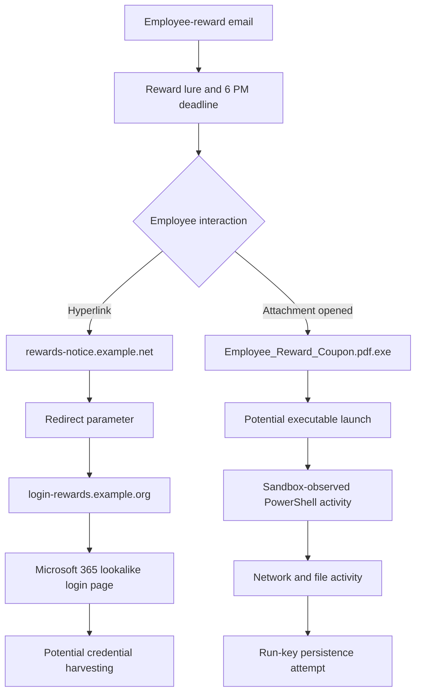
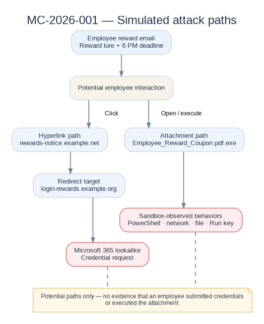
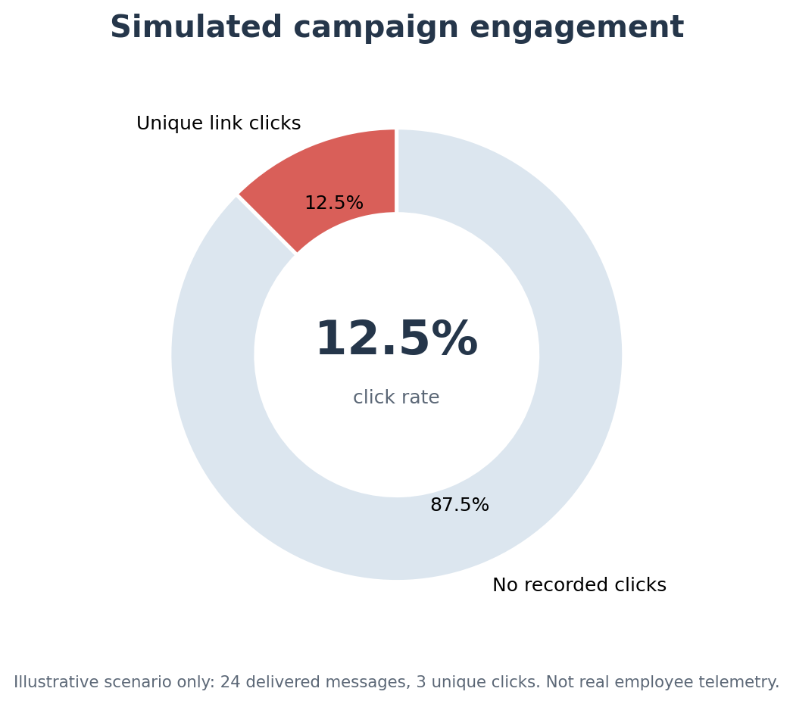
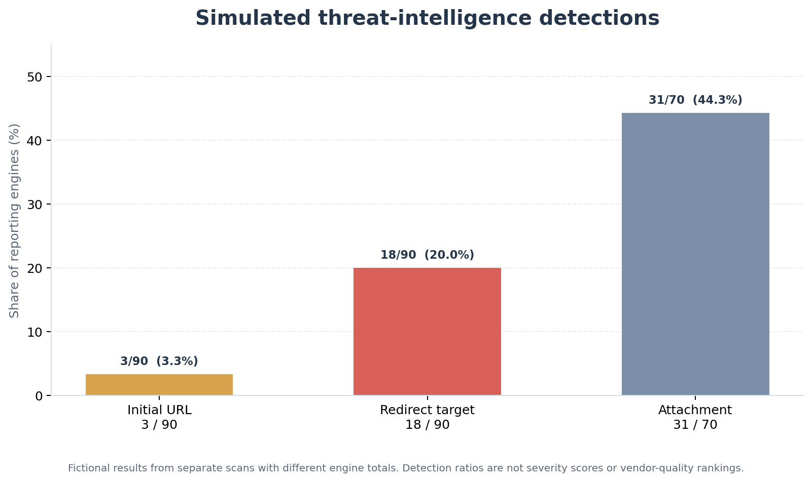
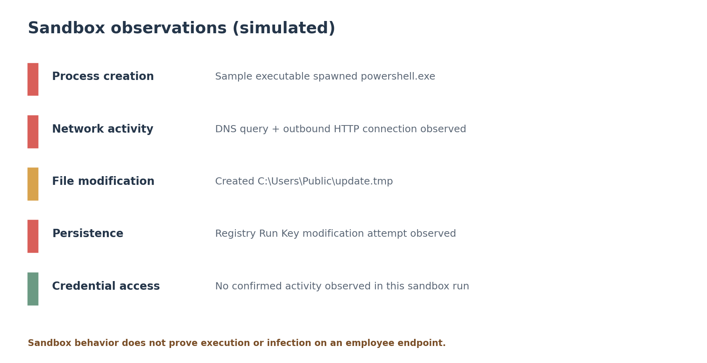
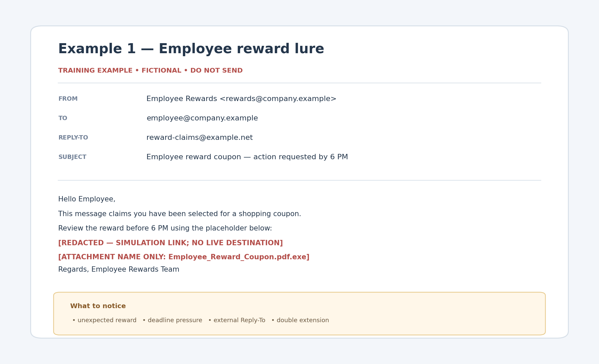
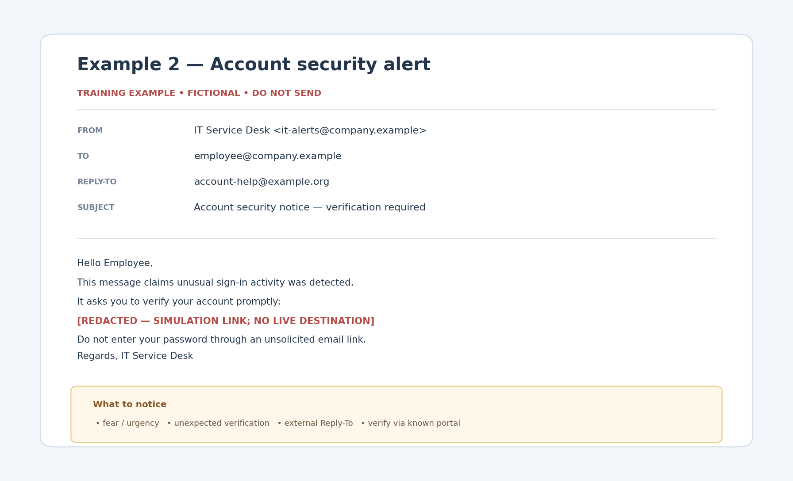

# Mastercard Phishing Simulation & Investigation Case Study

> **Training-only case study.** This repository documents a fictional phishing investigation and awareness exercise inspired by a Forage job-simulation task. It is not an investigation conducted for Mastercard, does not represent Mastercard systems or employees, and contains no real campaign telemetry.

## Project overview

This project demonstrates an end-to-end workflow for investigating a suspected phishing email, correlating email, URL, attachment, threat-intelligence, and sandbox evidence, and recommending incident-response actions. It also includes a short employee-awareness presentation and two fictional phishing examples for defensive recognition practice.

The scenario uses reserved example domains (`.example`, `example.net`, and `example.org`), documentation-only IP addresses, and fabricated hashes and detection results. The sample emails contain no live malicious links, payloads, or credential-collection mechanism.

## Objectives

- Analyze email headers and interpret SPF, DKIM, and DMARC results.
- Identify suspicious Reply-To, Return-Path, Message-ID, and Received-header patterns.
- Inspect URL structure, registered domains, hyperlink masking, and redirect parameters.
- Assess an attachment using its filename, file signature, SHA-256, reputation, and sandbox observations.
- Correlate evidence while separating observed facts from hypotheses and unknowns.
- Recommend proportionate containment, credential-protection, endpoint-response, and evidence-preservation actions.
- Explain phishing indicators to employees in clear, practical language.

## Scenario at a glance

A fictional employee receives an employee-reward email with a 6 PM deadline, an external hyperlink, and an attachment named `Employee_Reward_Coupon.pdf.exe`.

The simulated investigation produced these observations:

| Area | Simulated observation |
|---|---|
| Email delivery | 24 messages delivered to employees |
| User interaction | 3 unique URL clicks recorded (12.5% of delivered messages) |
| Email authentication | SPF PASS, DKIM PASS, DMARC FAIL due to domain misalignment |
| URL reputation | Initial URL: 3/90 detections; redirect target: 18/90 |
| Landing page | Microsoft 365 lookalike requesting an email address and password |
| Attachment | Double extension `.pdf.exe`; `4D 5A` signature; 31/70 detections |
| Sandbox | PowerShell child process, external network activity, file creation, and Run-key modification observed in the sandbox |
| Endpoint status | No matching execution event found in the scoped managed-endpoint search |
| Identity status | Credential submission and account takeover not established |

**Important interpretation:** the email is assessed as a phishing attempt in this fictional scenario. The attachment is assessed as likely malicious. The evidence does **not** establish that an employee submitted credentials or that an employee endpoint was infected.

## Repository map

```text
mastercard-phishing-investigation/
├── README.md
├── LICENSE-NOTE.md
├── .gitignore
├── docs/
│   ├── final-investigation-report.md
│   ├── evidence-and-methodology.md
│   ├── incident-response-playbook.md
│   ├── campaign-design-and-metrics.md
│   ├── lessons-learned.md
│   └── github-upload-guide.md
├── diagrams/
│   ├── README.md
│   ├── attack-flow.mmd
│   ├── evidence-correlation.mmd
│   └── incident-response-flow.mmd
├── evidence/
│   ├── evidence-matrix.csv
│   └── investigation-timeline.csv
├── metrics/
│   └── simulated-campaign-metrics.csv
├── samples/
│   ├── README.md
│   ├── phishing-example-01-employee-reward.eml
│   └── phishing-example-02-account-alert.eml
├── visuals/
│   ├── attack-flow.png / .svg
│   ├── campaign-metrics.png
│   ├── evidence-correlation.svg
│   ├── phishing-email-example-01.png
│   ├── phishing-email-example-02.png
│   ├── sandbox-observations.png
│   ├── threat-intelligence-detections.png
│   └── Mastercard_Phishing_Awareness_Montage.png
└── presentation/
    └── Mastercard_Phishing_Awareness_Training.pptx
```

## Attack-flow diagram

The two paths are separate potential attack vectors. They are not proof that both paths were completed by a recipient.





Source diagram: [`diagrams/attack-flow.mmd`](diagrams/attack-flow.mmd)

## Selected evidence

The full evidence register is in [`evidence/evidence-matrix.csv`](evidence/evidence-matrix.csv). Selected records:

| ID | Evidence | Observation | Limitation |
|---|---|---|---|
| E-01 | Email headers | Reply-To differs from the visible From domain | External vendor use is possible; authorization was not independently verified |
| E-02 | Authentication results | SPF PASS, DKIM PASS, DMARC FAIL | Authentication results alone do not establish message safety |
| E-03 | Email infrastructure | Return-Path, Message-ID, Received hostname, and initial URL share `example.net` | Correlation does not establish actor identity or ownership |
| E-04 | HTML hyperlink | Display text differs from the actual `href` destination | Static inspection only; no live click |
| E-05 | Redirect parameter | Target points to a different registered domain | A redirect parameter alone does not prove an open-redirect vulnerability |
| E-06 | Landing-page inspection | Microsoft 365 branding on an external domain; requests credentials | No evidence that a user submitted credentials |
| E-07 | URL reputation | Initial 3/90; redirect target 18/90 simulated detections | Multi-engine detection is supporting evidence, not a verdict by itself |
| E-08 | File metadata | `.pdf.exe` filename and `MZ` signature | File type indicators do not alone prove malicious behavior |
| E-09 | File reputation | 31/70 simulated detections | Multi-engine detection is supporting evidence, not a standalone verdict |
| E-10 | Sandbox | PowerShell, network, file, and Run-key behaviors | Sandbox behavior does not prove execution on an employee endpoint |
| E-11 | Mail gateway | 24 delivered; 3 unique clicks | Click telemetry does not prove credential submission or malware execution |
| E-12 | EDR | No matching execution event in the scoped search | Findings are limited to stated coverage and log window |
| E-13 | Identity provider | No confirmed suspicious successful sign-in | Account takeover is not established; all exposure is not ruled out |

## Investigation visuals

### Simulated campaign metrics



The 3/24 click rate is an illustrative calculation from the fictional scenario, not a result from a real employee campaign.

### Threat-intelligence detections



The percentages are detection ratios from separate simulated scans with different vendor totals. They should not be used as a direct measure of severity or vendor quality.

### Sandbox observations



## Full investigation report

The complete report is available in [`docs/final-investigation-report.md`](docs/final-investigation-report.md). Supporting methodology, response recommendations, and lessons learned are in the `docs/` folder.

## Awareness presentation

The four-slide employee-awareness presentation is included here:

- [PowerPoint presentation](presentation/Mastercard_Phishing_Awareness_Training.pptx)
- [Slide montage preview](visuals/Mastercard_Phishing_Awareness_Montage.png)

It covers phishing basics, common indicators, an illustrative email example, and practical steps employees can take.

## Phishing email examples (training only)

Instead of relying on unavailable screenshots, this repository includes two fictional email examples that employees can inspect:

1. [Employee reward lure](samples/phishing-example-01-employee-reward.eml) — reward incentive, deadline pressure, external Reply-To, and a disguised attachment filename.
2. [Account security alert](samples/phishing-example-02-account-alert.eml) — account-threat language, an unexpected verification request, and a mismatched reply address.

The messages are deliberately non-operational: URLs are redacted or use reserved example domains, and no payload is attached. They are examples for recognition and analysis, not templates to send to real targets.

### Example 1 — Employee reward lure



### Example 2 — Account security alert



## Campaign measurement (illustrative only)

The scenario contains 24 delivered messages and 3 unique clicks:

\[
\text{Click rate} = \frac{3}{24} \times 100 = 12.5\%
\]

This is **simulated scenario data**, not a measured employee response rate. No actual phishing campaign was distributed. Credential-submission and attachment-execution rates are unknown and must not be inferred from click counts.

See [`docs/campaign-design-and-metrics.md`](docs/campaign-design-and-metrics.md) and [`metrics/simulated-campaign-metrics.csv`](metrics/simulated-campaign-metrics.csv).

## Key lessons

- SPF and DKIM can pass while DMARC fails when neither authenticated domain aligns with the visible From domain.
- HTTPS does not prove that a site is legitimate.
- A displayed hyperlink label can differ from its actual destination.
- File extensions and magic bytes help identify file types but do not independently prove malware.
- A sandbox report describes the sample's behavior in the sandbox, not necessarily on a user's endpoint.
- Clicking a link is not the same as submitting credentials.
- Preserve evidence and scope the incident before taking disruptive response actions.

## Scope, limitations, and ethical use

- This is a fictional training case study based on a learning exercise; it is not an official Mastercard assessment or a real Mastercard incident.
- All domains, email addresses, IP addresses, file hashes, vendor detections, logs, and observations in the case are fabricated for training.
- `example.net`, `example.org`, and `.example` are used as example domains; `198.51.100.0/24` is a documentation IP range.
- No employees were targeted, no live phishing emails were sent, no credentials were collected, and no real malware was executed.
- No click, credential-submission, infection, or account-compromise result should be presented as a real-world measurement.
- Any real phishing-awareness campaign should have written authorization, a defined scope, privacy safeguards, an approved landing page, safe telemetry, and a response plan.

## Publishing this repository

See [`docs/github-upload-guide.md`](docs/github-upload-guide.md) for repository setup and pre-publication checks. This package is prepared locally and has not been published to GitHub.

## Suggested GitHub repository description

`A fictional end-to-end phishing investigation case study covering email authentication, URL analysis, attachment triage, evidence correlation, incident response, and employee security awareness.`

## Suggested topics

`phishing-analysis` `email-security` `soc-analysis` `incident-response` `threat-intelligence` `malware-analysis` `security-awareness` `forage-simulation`
